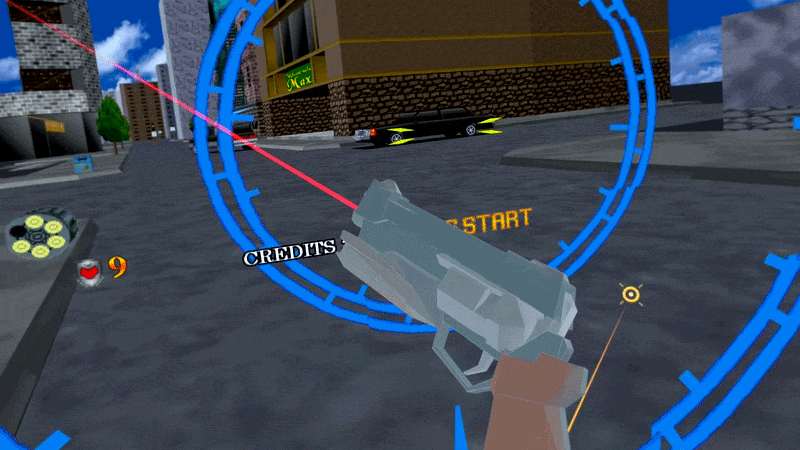

# Virtua Cop 2 VR (VC2VR) - v1.0 beta

A native VR mod for the 1997 PC port of **Virtua Cop 2**. The mod intercepts the
game's renderer, rebuilds the real 3D scene from the geometry the engine draws
every frame, and renders it for the headset through OpenXR. Your motion
controller is the light gun.



* Full 6DoF view of the actual level, 360 degrees around you
* Motion-controller light gun with a laser sight and a revolver model in the hand
* Two controllers = two guns (akimbo), the second one plays as player 2
* The game's cinematic zoom moments are mirrored automatically
* Menus and score screens on a floating screen you click with the laser
* The game's own sky, wrapped onto a dome
* No game files are modified on disk

## Requirements

* Your own copy of Virtua Cop 2 for PC (1997). No game files are included.
* A PC VR headset with an OpenXR runtime (SteamVR, Meta Link, etc.)
* Windows x64

## Installation

Nothing to configure. Copy the contents of the release zip into the game
folder, next to `PPJ2DD.EXE`, and run `VC2VR.exe`.

If the game did not start from its own folder even before the mod (it dies
with a `...BIN\MOTCMN.BIN` not found error), its 1997 loader wants the data one
level up. Create a `PROJECT` folder inside the game folder, copy every file
from the game folder into it (files only, `BIN` stays where it is), copy the
mod in there too, and run everything from `PROJECT`.

## Running

1. Start your VR runtime.
2. Run `VC2VR.exe`. It starts the game, switches it to the mod's renderer and
   to windowed mode (`vcop2.ini`), brings the game window to the front and
   connects. Full-screen mode does not work with the mod. Keep the game's
   disc image mounted - the music comes from it.
3. Put the headset on facing your monitor - the first head pose becomes the
   camera. Squeeze the grip to recentre at any time.

`VC2VR.exe --window` renders to a flat window instead of the headset, which
tells a game-side problem from a VR-runtime one.

## Controls

| Input                 | Action                                            |
|-----------------------|---------------------------------------------------|
| Trigger               | Fire                                              |
| A / X                 | Reload (Start / Enter in menus)                   |
| B / Y                 | Back (Esc)                                        |
| Thumbstick - flick up | Zoom toggle                                       |
| Thumbstick - click    | Floating menu screen: auto / always / off         |
| Grip                  | Recentre                                          |

With akimbo on, the second controller is player 2: press its A / X to join.

## Local multiplayer

A second person can play on the monitor. `window = 1` in HGL_VIEW.ini opens a
flat view of the same world (F11 for full screen); the second controller is
player 2, aiming by the game's own crosshair on that window. Set
`hidexhair = 3` in HGL_VIEW.ini so that crosshair stays visible, and
`akimbo = 1` in both ini files (the release ships with it on).

## Configuration

`VC2VR.ini` - VR side: picture quality, zoom, gun model, akimbo.
`HGL_VIEW.ini` - game side: world scale (`units_per_metre`), 360-degree
machinery, HUD. Both files are short and commented.

## Rendering glitches

The world is reconstructed from what a 1997 software renderer emits, not from
level files, so some sections show odd polygons, wrong draw order or a missing
backdrop. These are fixed by hand, one at a time, and the whole game is
playable from start to finish.

Part of what looks broken was simply never drawn: the game rendered a narrow
window from a fixed angle, and what lay outside it - floors under the camera,
the backs of things - does not exist in the data. A zoom through a scope on
the gun was tried and dropped; it does not fit this kind of gameplay.

Doing this properly means remaking the game for VR from scratch, which is
beyond this project. This is close to as far as the approach can go.

## How it works

The game draws through a pluggable renderer DLL. `HGL_VIEW.DLL` sits in front
of it, takes every polygon with the transform the engine used that frame, draws
the scene five more times with the camera turned to get the full 360 degrees,
and publishes geometry, textures and depth keys to shared memory. `VC2VR.exe`,
a separate 64-bit process, renders that for both eyes via OpenXR and feeds the
controller aim back into the game's light-gun input.

## Building from source

Cross-compiles from Linux with mingw-w64 (gcc 13). OpenXR headers go into
`./inc/openxr/` (from the Khronos OpenXR-SDK, or `apt install libopenxr-dev`).

```
i686-w64-mingw32-gcc -O2 -s -shared -Wl,--kill-at -Wl,--image-base=0x69600000 \
    -o HGL_VIEW.DLL src/hgl_view.c -static-libgcc \
    -lgdi32 -luser32 -ld3d11 -ld3dcompiler -ldxguid -lole32 -lwinmm
x86_64-w64-mingw32-gcc -O2 -s -Iinc -o VC2VR.exe src/vc2vr.c \
    -ld3d11 -ldxgi -ld3dcompiler -ldxguid -luuid -lgdi32 -luser32 -lole32
```

Both build the released binaries byte for byte, bar the PE timestamp. The DLL
must be named exactly `HGL_VIEW.DLL`, and the game loads every file whose name
starts with that, so keep one.

Two diagnostics live in the DLL, off by default: `floorprobe` (lists the flat
objects under the camera) and `shotlog` (every sprite of every frame for N ms
after the trigger). `feetfill` lays copies of the nearest floor tile under the
feet; it turned out unnecessary and stays off.

## Changelog

**v1.0 beta**
* 360-degree rendering - you can look behind you. The engine only ever draws
  a 60-degree window, so the scene is drawn five more times with the camera
  turned and every object the engine ever shows is remembered
* Revolver model in the hand (OBJ + BMP texture), recoil and reload animation
* Akimbo - second controller as player 2, local multiplayer on the monitor
* Better VR sights: laser from the muzzle, angle-sized dot
* HUD tied to the zoom and drawn sharp
* Fixed the brightness (gamma) and the wrong world scale
* Sky dome nailed to the world, distant backdrops pushed out along their rays
* A good part of the rendering glitches fixed; a fair number remain
* Full source of the DLL, including the light-gun input module

**v0.9 beta** - first public build.

## Legal

This mod contains no assets or code from Virtua Cop 2. It is a fan-made
interoperability project, free, as-is, for owners of the original game.
Virtua Cop 2 is (c) SEGA. Not affiliated with or endorsed by SEGA.
`openxr_loader.dll` is from the Khronos OpenXR SDK (Apache 2.0).
